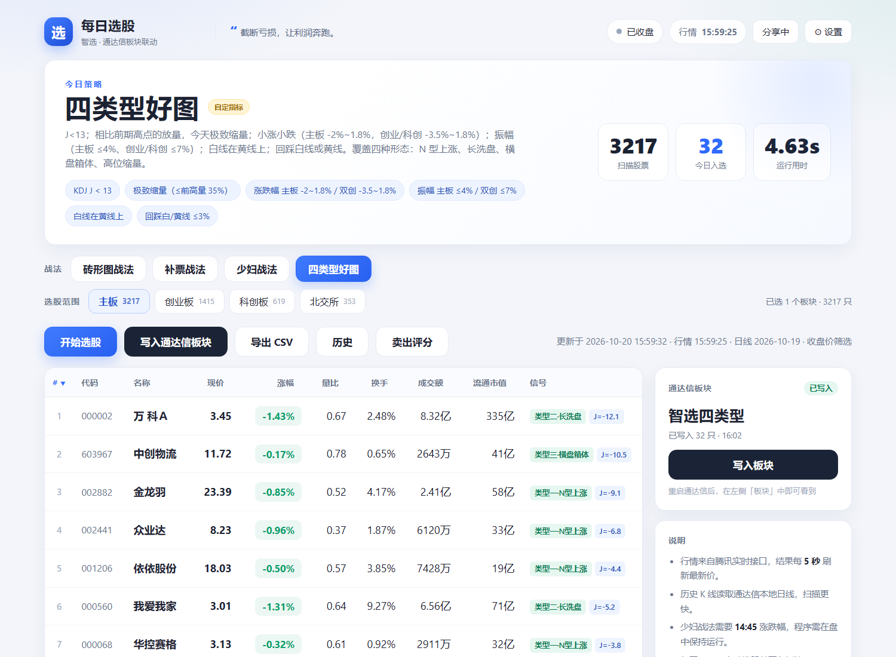

# 每日选股 · 智选



跑在你自己电脑上的 A 股每日选股工具：**四个自定义战法 + 实时行情 + 通达信本地日线 + 自动创建通达信板块**。

- 战法可切换：**砖形图战法 / 补票战法 / 少妇战法 / 四类型好图**
- 选股范围可多选：**主板 / 创业板 / 科创板 / 北交所**
- 全市场 5000+ 只，扫描约 7 秒；结果每 5 秒刷新最新价
- 选出的股票自动写入通达信「自定义板块」，板块名随战法区分
- 每天 15:05 自动选股并写入；可生成公网链接分享（访客只读）
- 内置 **K 线训练营**：真实历史 200 根双盲回放、模拟交易统计、形态图鉴/测验/截图分析

---

## 一、快速开始

1. 双击桌面 **「每日选股」** 快捷方式（或项目里的 **`启动选股系统.bat`**，或执行 `python server.py`）
   - 服务已在运行时，双击只会打开网页，不会重复启动
2. 浏览器打开 **http://127.0.0.1:8765**
3. 选「战法」和「选股范围」→ 点「开始选股」→ 点「写入通达信板块」
4. 重启通达信，左侧「板块」中即可看到对应板块

> **已配置开机自启**：登录 Windows 后会自动在后台静默启动（不弹黑框、不打开浏览器），
> 桌面「每日选股」快捷方式负责打开页面。取消方法：删除启动文件夹里的
> `每日选股（开机自启）.lnk`（`Win+R` 输入 `shell:startup` 即可打开该文件夹）。
> 后台启动脚本是项目里的 `后台运行.vbs`。

## 二、四个战法

### 1. 砖形图战法（`智选砖形图`）

1. 股价在黄线上
2. 股价距离白线或黄线（满足其一）小于 5%
3. 砖型图**由绿转红**：红砖前两根内至少有一根绿砖，且红砖实体 ≥ 最近一根绿砖实体的 2/3

**每天只保留当日选出的股票**，不再跨日保留。

### 2. 少妇战法（`智选少妇战法`）

1. 白线在黄线上
2. KDJ 的 J 值 ≤ 35 且 > -20
3. 当天 **14:45** 时涨跌幅的绝对值 < 2.45%

**14:45 从哪来**：程序每天 14:45（交易日）会自动抓一次全市场涨跌幅快照，15:05 选股时使用。
如果程序 14:45 没在运行，会用当前涨跌幅代替，并在页面提示「14:45 快照缺失」。

### 3. 补票战法（`智选补票`）

1. **白线在黄线上**（这里的白线/黄线指黄白线「双线」指标：白=EMA(EMA(C,10),10)，黄=(MA14+MA28+MA57+MA114)/4）
2. 补票指标的**白线（短期 3 日）与红线（长期 21 日）此前都在 75 上方**
3. 白线跌破 75，并且**下探到 20 以下**；跌破期间**红线始终保持在 75 以上**
4. 随后在 **1~5 个交易日内白线重新回到 75 上方**（今天上穿 75）

也就是「强势回踩、白线下探 20 以下、红线守住 75、1~5 日内快速收回」的补票买点。

### 4. 四类型好图（`智选四类型`）

来源：《四种类型 十张好图.pdf》。核心标准归纳为：

1. **KDJ 的 J < 13**（b1 低位）
2. **极致缩量**：今天成交量 ≤ 前 20 日最大量的 35%，且 ≤ 5 日均量的 85%（相比前期放量明显缩量）
3. **小涨小跌**：主板 -2% ~ +1.8%；创业板 / 科创板 -3.5% ~ +1.8%
4. **振幅受限**：主板 ≤ 4%；创业板 / 科创板 ≤ 7%
5. **白线在黄线上**（双线多头）
6. **回踩支撑**：最低价距白线或黄线 ≤ 3%
7. 前期放过量：前 20 日最大量 ≥ 前 60 日均量的 1.4 倍

命中后会按形态打标签（四类之一）：

- **类型一·N 型上涨**：好看的 N 型上涨中缩到地量的小 K 线（最佳形态）
- **类型二·长洗盘**：前高放量/大阴线后长时间震荡洗盘，再出地量小 K
- **类型三·横盘箱体**：放量拉升后压缩为横盘缩量，在箱体下沿/黑线处出 J 大负值
- **类型四·高位缩量**：大幅上涨后高位缩量涨、顶部未放量，地量 + 踩黑线（不能跌破黑线）

## 三、指标公式（已按截图实现）

全部在 `core/indicators.py`：

**黄白线**

- 白线（知行短期趋势线）= `EMA(EMA(C,10),10)`
- 黄线（知行多空线）= `(MA(C,14)+MA(C,28)+MA(C,57)+MA(C,114))/4`

**砖型图**

```
VAR1A:=(HHV(HIGH,4)-CLOSE)/(HHV(HIGH,4)-LLV(LOW,4))*100-90;
VAR2A:=SMA(VAR1A,4,1)+100;
VAR3A:=(CLOSE-LLV(LOW,4))/(HHV(HIGH,4)-LLV(LOW,4))*100;
VAR4A:=SMA(VAR3A,6,1);
VAR5A:=SMA(VAR4A,6,1)+100;
VAR6A:=VAR5A-VAR2A;
砖型图:=IF(VAR6A>4,VAR6A-4,0);
```

**补票战法四线**（N1=3，N2=21）

```
短期  = 100*(C-LLV(L,3)) /(HHV(C,3) -LLV(L,3))
中期  = 100*(C-LLV(L,10))/(HHV(C,10)-LLV(L,10))
中长期= 100*(C-LLV(L,20))/(HHV(C,20)-LLV(L,20))
长期  = 100*(C-LLV(L,21))/(HHV(C,21)-LLV(L,21))
```

**KDJ(9,3,3)**

```
RSV = (C-LLV(L,9))/(HHV(H,9)-LLV(L,9))*100
K = SMA(RSV,3,1)   D = SMA(K,3,1)   J = 3K-2D
```

## 四、数据从哪来

| 数据 | 来源 | 说明 |
|---|---|---|
| 实时价格 / 涨幅 / 量比 / 换手 / 市值 | 腾讯行情 `qt.gtimg.cn` | 每批 60 只、6 线程，几秒拉完全市场 |
| 历史日线（均线、砖型图、KDJ、四线） | 通达信本地 `vipdoc/*/lday/*.day` | 读取盘后数据，无网络依赖 |
| 兜底行情 | 新浪 `hq.sinajs.cn` | 腾讯异常时补齐基础价格 |

**收盘后筛选用收盘价**：15:00 之后或非交易日扫描时，程序自动改用当日日线的收盘价计算指标——
本地日线已有当天数据就直接用本地收盘价（与客户端 K 线一致），没有则用行情接口的收盘价。
页面右上角会标注「收盘价筛选」。

> 本地日线是**不复权**数据；若个股近期大比例除权，指标与通达信前复权图可能有细微差异。需要的话可以再加前复权处理。

**没装通达信也能用**：程序会自动切换到「在线数据模式」，用网络前复权日线计算指标。
第一次选股需要为全市场约 5000 只股票下载日线（约 2~3 分钟），当天之后复用缓存；
此模式下可以选股、看结果、导出 CSV，但不能写入通达信板块。

## 五、板块是怎么写进去的

- `T0002\blocknew\blocknew.cfg`：每条 120 字节（板块名 50 + 文件名 50 + 保留 20，GBK）
- `XXX.blk`：每行 7 位 = 市场前缀（0 深 / 1 沪 / 2 京）+ 6 位代码

写入前会**先清空该板块原有股票**，只保留本次名单；旧 `.blk` 和 `blocknew.cfg`
都会备份到 `data\backups\`，误操作可恢复。同名板块只更新名单，不重复创建。

**写入前必须先关闭通达信**：客户端运行时会用内存里的旧名单覆盖文件。
网页点「写入板块」时会检测并提示，确认后自动关闭通达信、写入、再重启客户端。
写入完成后会提示「清空原 N 只 → 写入 M 只」。

## 六、设置

- 通达信安装目录、板块名前缀、每期最多入选（**默认 0 = 不限**，填 0 表示全部符合条件都入选）
- 自动任务：每天 15:05 选股、可自动写入
- 分享：是否允许访客自己选股
- 过滤条件：ST / 价格区间
- 战法参数：当前战法的阈值（J 值、缩量比例、振幅、回踩距离等）可直接修改，保存后下一次选股生效

选股范围（板块）和战法在主界面直接切换，会记住上次选择。

**结果排序**：点击表头即可按 代码 / 名称 / 现价 / 涨幅 / 量比 / 换手 / 成交额 / 流通市值 排序，
再点一次切换升降序；点 `#` 按综合评分排序。排序会记住，也支持用链接分享，例如
`http://127.0.0.1:8765/?sort=pct&dir=desc`。排序只影响显示，不改变写入板块的名单。

## 七、看图 / 历史 / 参数

- **K 线图**：点结果里的任意一行，弹出该股 K 线。主图是 K 线 + 白线 + 黄线，
  中间固定显示**成交量**（含 5 日量均线），下方显示**当前战法对应的指标**：
  - 砖形图战法 → 砖型图
  - 补票战法 → 补票四线（短期/中期/中长期/长期，带 75/20 参考线）
  - 少妇战法 / 四类型好图 → KDJ(9,3,3)
  蓝色虚线标出入选那一根 K 线，支持滚轮缩放。
- **历史记录**：点「历史」，按日期查看每天选出的股票，并统计入选后
  **1 / 3 / 5 / 10 个交易日**的平均涨跌幅和胜率。历史文件在 `data/history/`，
  每天每个战法保留最后一次。
- **战法参数**：设置抽屉里的「战法参数」可调当前战法的阈值，保存后下一次选股生效。

## 八、分享给朋友

点右上角「分享」，生成 `https://xxxx.trycloudflare.com` 链接。访客可查看和选股，
但**写入通达信、改设置只限本机**（公网请求返回 403）。程序重启后链接会变化。

## 九、目录结构

```
每日选股/
├─ 启动选股系统.bat
├─ 启动K线训练.bat        直接打开 K线训练营
├─ 创建桌面快捷方式.bat   创建/刷新「每日选股」「K线训练」桌面快捷方式
├─ 更新发布包.bat         一键同步发布目录、压缩包、桌面快捷方式
├─ server.py              本地服务 + 定时任务 + 分享
├─ core/
│  ├─ indicators.py       全部指标公式  ← 改指标
│  ├─ strategies.py       四个战法定义  ← 改条件
│  ├─ chart_series.py     K线图序列（黄白线/砖型图/KDJ）
│  ├─ sell.py             卖出评分（五种出货方式）
│  ├─ history.py          历史记录与后续收益统计
│  ├─ online.py           无通达信时的在线日线
│  ├─ training.py         训练历史切片/周期聚合/形态测验
│  ├─ patterns.py         K线形态识别引擎（图鉴+匹配）
│  ├─ pattern_cases.py    历史形态案例扫描与缓存
│  ├─ shape_match.py      手绘形态匹配最近N日股票
│  ├─ book_outline.py     电子书章节/小标题目录
│  ├─ murphy_library.py   墨菲原书章节形态库
│  ├─ snapshot.py         14:45 涨跌幅快照
│  ├─ engine.py           选股引擎
│  ├─ quotes.py           腾讯/新浪行情
│  ├─ tdx_local.py        通达信日线与板块分类
│  └─ tdx_block.py        板块写入
├─ tools/
│  └─ sync_release.py     发布同步 / 压缩 / 快捷方式刷新
├─ web/                   网页界面（含本地 echarts）
│  ├─ training.html       K线训练营
│  ├─ training.css
│  ├─ training.js         训练场 + 数据统计
│  ├─ pattern-lab.js      形态图鉴/测验/截图分析/手绘选股
│  └─ book.js             电子书阅读器
└─ data/
   ├─ config.json / last_result.json
   ├─ book/               电子书页和目录（本机生成，不入发布包）
   ├─ history/            每日选股历史
   ├─ kline/              在线日线缓存
   └─ backups/            板块备份
```

## 十、卖出评分

顶部点「卖出评分」，输入 6 位代码即可得到 0~100 分和结论（持有 / 观察 / 减仓 / 卖出），
K 线图上用红色 **S** 标出**最近 30 个交易日**内的卖点。

评分依据《主力出货的 5 种方式》：

| 信号 | 含义 | 分值 |
|---|---|---|
| S1 | 加速后单日放天量大阴线（成交量创 20 日新高） | +45 |
| S2 | 加速后次高点突然巨量长阴 | +40 |
| S3 | 新高后连续阶梯放量下跌，跌破白/黄线 | +30 |
| S4 | 双头双放量巨阴 | +32 |
| S5 | 顶部绿长红短（绿肥红瘦） | +22 |
| 大风车 | 巨量长上影、收在当日低位 | +32 |
| 破白线 / 破黄线 | 收盘跌破短期趋势线 / 多空线 | +15 / +15 |
| 其它 | 20 日涨幅过大、J>100、放量滞涨、高位长上影 | +5 ~ +8 |

结论：**≥60 卖出，40~59 减仓，20~39 观察，<20 持有**。

结果按 **顶部形态 / 趋势破位 / 量能异常 / 位置过热** 四类卡片展示，
上方有一条 持有 → 观察 → 减仓 → 卖出 的风险分档条，指针就是当前分数。

**没有马后炮**：每个信号都只用「当天及以前」的数据逐根计算，
图上的 S 就是当天收盘后能看到的卖点，不会参考后面的走势。

## 十一、交易打卡

顶部点「打卡」打开小交易日历：

- 点某个交易日 → 输入**当日盈亏**（正数盈利、负数亏损）→ 保存
- 日历上红色显示盈利、绿色显示亏损，蓝点表示已打卡
- 顶部统计：本月盈亏、本月打卡天数、胜率、连续打卡
- 日期按通达信交易日显示，周末和节假日不可点
- **数据只保存在本机浏览器**（localStorage），不上传；换浏览器或清缓存会丢失

## 十二、常见问题

**Q：少妇战法显示「14:45 快照缺失」？**
程序当天 14:45 没运行。保持程序在盘中运行即可；缺失时用当前涨跌幅代替。

**Q：补票战法结果不符合预期？**
补票按「白线跌破 75、下探 20 以下、红线守住 75、1~5 日内白线收回 75」实现。若你对白/黄线的定义不同，告诉我，改 `core/strategies.py` 的 `Bupiao.match` 即可。

**Q：写入成功但通达信里看不到？**
重启一次通达信，板块在启动时加载。

**Q：选股结果为 0？**
换板块范围或放宽条件；非交易日会得到上一交易日结果。

---

*本工具仅用于个人选股研究，不构成投资建议。*


## 十三、部署到云端（24 小时在线）

想不依赖自己的电脑、随时打开网页，需要一台云服务器，按**源码包**里的 `deploy/README.md` 用 Docker 部署：

- 云端自动使用在线行情（腾讯/新浪），**读不到本地通达信，也不能写本地板块**
- `docker compose up -d --build` 一条命令启动，Caddy 自动申请 HTTPS
- 定时任务、历史、打卡照常运行，服务器重启会自动拉起
- 成本约 ¥24~60/月（轻量服务器）+ 域名；大陆节点绑域名需备案

详细步骤见**源码包**中的 `deploy/README.md`。

## 十四、K 线训练营


首页右上角「K线训练」进入，或直接打开 **http://127.0.0.1:8765/training**。

### 1. 200 根真实历史回放

- 支持 **1 / 5 / 15 / 30 / 60 分钟、日线、周线、月线** 八种周期
- 从真实历史行情中随机截取 200 根K线，**隐藏股票名称与日期**（双盲）
- 开局可选先看 30 / 60 / 90 根，然后逐根「下一根」或自动播放（1× / 2× / 4×）
- 模拟账户 100 万：买入 / 卖出、5% / 10% / 1/4 / 1/3 / 半仓 / 2/3 / 75% / 全仓，另可拖动 5%~100% 自定义仓位，按 100 股整数手成交
- 计入佣金 0.025%（最低 5 元）和卖出印花税 0.05%；结束或揭晓时自动结算未平仓持仓
- 结束后揭晓股票、代码、真实日期区间，并自动记录本局成绩
- 快捷键：`Space` 下一根、`B` 买入、`S` 卖出
- 图表右上角「指标」可调主图/副图指标和参数，参数会记住，下一局继续使用

### 1.1 指标设置

训练页的「指标」按钮打开技术指标面板，当前可见的 K 线会立即重算：

- **主图叠加**：均线 MA（默认周期 5/10/20/60）、黄白线（白线 `EMA(EMA(C,N1),N2)`，黄线四条均线平均）
- **副图指标**：成交量固定显示；上方可同时添加最多 3 个指标（砖形图 / KDJ / 补票四线），加成交量共 3 或 4 个副图
  - 点指标按钮添加，点按钮右上角 `×` 移除；再点已添加的按钮可切换参数编辑
  - 每次添加/移除后 K 线图会自动重新分配主图和各副图高度
- **可调参数**：
  - 均线：4 条均线周期
  - 黄白线：白线两条 EMA 周期、黄线四条 MA 周期
  - 砖形图：高低周期、平滑1、平滑2、二次平滑、显示阈值
  - KDJ：周期 N、平滑 M1、平滑 M2、超买线、超卖线
  - 补票四线：短期/中期/中长期/长期四条线的周期、关键位（默认 75）
- 图表下方会显示当前最后一根K线的指标数值；鼠标悬停时提示框也会显示对应指标值
- 参数只影响指标显示，不影响模拟交易与成绩统计；参数保存在本机浏览器 `localStorage`

默认公式与主选股页一致：

| 指标 | 默认值 / 公式 |
|---|---|
| 白线 | `EMA(EMA(C,10),10)` |
| 黄线 | `(MA(C,14)+MA(C,28)+MA(C,57)+MA(C,114))/4` |
| 砖形图 | `VAR6A` 红绿柱，阈值 4，高低周期 4，平滑 4/6/6 |
| KDJ | `KDJ(9,3,3)` |
| 补票四线 | 3 / 10 / 20 / 21 日，关键位 75 |

### 2. 模拟数据统计

「数据统计」页会把每局成绩存在本机浏览器，包含：

- 累计训练局数、交易笔数、综合胜率、累计收益率、平均收益率、收益盈亏比、平均最大回撤
- 按每局收益率复利计算的净值成长曲线
- 分周期表现（日线/周线/分钟线各自的平均收益与胜率）
- 最近训练明细，可一键导出 CSV
- 可生成 **训练数据总结图片**（累计收益、曲线、最近训练），也可一键清空全部训练数据
- 训练场右侧也显示累计收益率、综合胜率、盈亏比，不用切到统计页就能看到
- 形态测验的答题数、正确率、最高连对

> 训练记录保存在浏览器 `localStorage`，不会上传服务器；清空浏览器缓存会丢失。

### 3. K 线形态分析

形态库按约翰·墨菲《期货市场技术分析》（1994 中文版）组织：第4章趋势与缺口、第5章主要反转形态、第6章持续形态。本书没有日本蜡烛图章节，因此不收录十字星、吞没等K线定义。
完整学习摘要见 [docs/murphy-pattern-notes.md](docs/murphy-pattern-notes.md)；正版电子版可在
[微信读书](https://weread.qq.com/web/bookDetail/ec532a80811e7852fg019f7d) 阅读。

「形态分析」分四块：

1. **形态图鉴**：22 种结构形态；点开任一形态会显示**书中要点摘录和页码**、识别规则，
   以及 3 个从本地历史扫描出的**历史案例**，案例可点开看形态完成点之后的大图
2. **形态测验**：从真实历史中自动扫描典型形态出题，每段展示 90 根K线，只判断蓝框内的最后 55 根，右侧有同一区域的放大图；四选一，答完给出形态要点与案例
3. **截图分析**：把客户发来的 K 线截图拖入页面（支持多张、粘贴、自动框选、手动调整），
   在浏览器内还原出 OHLC 后匹配最接近的技术形态
4. **手绘选股**：在画板上画一段走势，只扫描最近 5/10/20/30 个交易日内结束的形态，
   按相似度 + 最近程度排序，结果可看匹配区间和形态后的表现

关于截图分析，需要说明它的实现方式：

- **不是把图片发给大模型**。截图只在浏览器里解析，原图不出本机；页面只把还原出的
  OHLC 数据 POST 给本地 Python 形态引擎。
- 需要截图里是**清晰的红绿或红青 K 线**，且框选区域只包含价格K线，避开成交量副图、指标和文字。
- 页面会显示还原后的K线供核对；识别不准时重新框选即可。
- 价格轴是从像素纵向比例还原的**图内相对价格**，所以页面上的支撑/压力/涨跌幅都是相对值，
  用来判断形态，不等同于真实价位。
- 形态匹配度是规则模型的**相似度**，不是上涨/下跌概率；结果仅供技术分析训练参考。

### 4. 电子书阅读器

顶部「电子书」进入按章节阅读的页面：

- 左侧目录按 **16 章 + 小标题** 组织，可搜索、可跳页
- 右侧按论文纸张样式显示书页，支持上一页/下一页、页码跳转、缩放和键盘翻页
- 章节/小标题页码保存在 `core/book_outline.py`，页面图片来自本机 PDF

先生成一次书页（只需一次）：

```bat
pip install pypdf Pillow
python tools/build_book.py
python tools/build_book_manifest.py
```

书页写到 `data/book/pages`，**不会打进免安装包或源码包**，避免版权文件随发布包传播；换电脑后需要在本机重新生成。

### 5. 数据来源

| 周期 | 来源 | 说明 |
|---|---|---|
| 日 / 周 / 月 | 通达信本地 `vipdoc/*/lday` | 周/月由日线聚合；月线不足 200 根时自动改用腾讯长历史 |
| 1 / 5 / 15 / 30 / 60 分钟 | 腾讯分钟历史行情 | 本地 `minline` 为空时使用，按周期缓存 |
| 股票名称 | 腾讯实时行情 | 仅在本局揭晓时获取，训练中不返回 |

训练数据全部来自真实历史行情，不含随机生成的价格；但随机截取片段、隐藏日期与名称，
所以同一只股票、同一段行情可能会在不同局中再次出现。

## 十五、桌面快捷方式、安装包与更新

### 1. 桌面快捷方式

项目根目录新增：

- `启动K线训练.bat`：服务已在运行时直接打开 `/training`；未运行时自动启动服务并打开训练页
- `创建桌面快捷方式.bat`：在当前用户桌面创建/刷新「每日选股」和「K线训练」两个快捷方式
- `assets/training.ico`：K线训练专用图标

桌面快捷方式指向项目根目录的启动脚本，所以**移动项目目录后重新运行一次
`创建桌面快捷方式.bat` 即可**。免安装版解压后也可以运行这个 bat 创建本机快捷方式。

### 2. 一键更新发布包（源码目录使用）

以后改完代码，双击根目录的 **`更新发布包.bat`**（或运行 `python tools/sync_release.py`），
它会一次性完成：

1. 同步当前项目到 `发布/每日选股`（免安装版目录，保留其中的 `python` 运行环境）
2. 同步当前项目到 `发布/源码/每日选股_源码`（源码版目录）
3. 重新生成 `发布/每日选股_免安装版.zip`
4. 重新生成 `发布/源码/每日选股_源码.zip`
5. 刷新桌面「每日选股」「K线训练」快捷方式

只打包、不刷新快捷方式：

```bat
python tools\sync_release.py --skip-shortcut
```

同步时会排除 `data`、`bin`、`__pycache__`、`.git`、测试脚本和临时截图；发布包里的
`python` 目录不会被覆盖。发布包的目录结构和桌面快捷方式都按同一套规则生成，
避免出现「代码更新了、压缩包还是旧版」的情况。

> 如果本次更新包含 `server.py` 或 `core/*.py` 的修改，已经打开的服务需要重启一次才会加载新代码；
> 只改 `web/` 下的 HTML/CSS/JS 时刷新浏览器即可生效。

### 3. 发布目录

| 路径 | 用途 |
|---|---|
| `发布/每日选股/` | 免安装版目录运行文件 |
| `发布/每日选股_免安装版.zip` | 发给朋友的无 Python 环境压缩包 |
| `发布/源码/每日选股_源码/` | 源码版目录 |
| `发布/源码/每日选股_源码.zip` | 源码包（含训练/形态模块、部署脚本、更新脚本） |

## 十四、活跃市值（0AMV）

选股区中间新增「活跃市值 0AMV」卡片，显示当前值、日变化和最近 120 个交易日的日 K 线（红绿砖 + EMA12 平滑线），支持滚轮/滑块缩放，悬停显示开收高低和涨跌幅。

- 公式：公开流传的民间 0AMV 口径 `SMA(沪深全市场成交额, 10, 1) / 1e7`
- 成交额来源：通达信本地「上证指数 + 深证综指」日线的 amount 字段，不额外联网
- 指南针未公开原版算法，本卡片是**代理指标**，形态接近但不保证与客户端数值完全一致

- 少妇战法提示：0AMV 单日 ≤ -2.3% 后逐步减仓；单日 ≥ +4%，或连续两日合计 ≥ +4%，才重新适用（卡片内显示当前状态）


## 十五、ETF 选股

顶部「ETF选股」进入独立页面（主页面战法栏也有入口）。

- **不设主板/创业板等板块**，只分三类：**纯血**（1 个板块）、**混血**（2 个板块）、**股指**（宽基/境外指数单列）
- 条件与少妇战法类似，但全部用**周 K**：白线在黄线上；周 KDJ 的 J ∈ (-20, 35]；周涨跌幅绝对值 < 2.45%
- 列表标注类别和板块，例如「纯血 · 有色」「混血 · 电子 + 计算机」「股指 · 沪深300」
- 首次全量扫描约 10 秒，切换纯血/混血/股指走缓存，秒开
- 悬停任意 ETF 行：右下角显示周 K（白/黄线 + 成交量 + KDJ）；**右键**在周 K/日 K 间切换，滚轮缩放

**归类说明**：ETF 持仓和行业归属没有稳定的本地数据，目前按**基金名称/跟踪指数**归类（如名称含「半导体」→ 半导体，含「科技」→ 电子+计算机），不是真实持仓穿透，仅供参考。后续可接基金持仓数据做精确归类。

